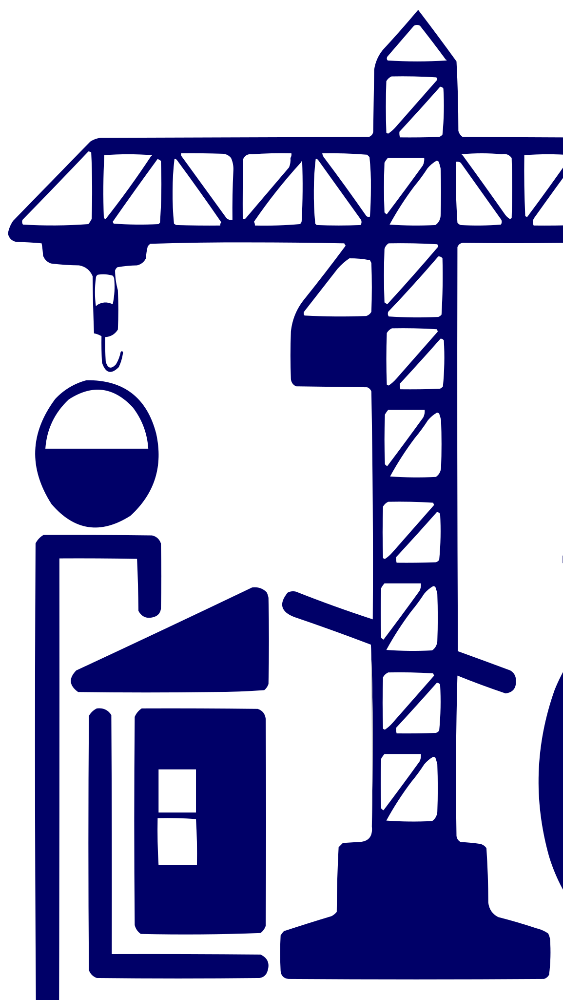

<h1 align="center">
  
  OPEN
</h1>

# OPEN FAQ

**OPEN** is the infrastructure advisory branch of [OPEN SARL](mailto:contact@open-consulting.fr), based in Kinshasa. It helps national and provincial authorities in the Democratic Republic of the Congo and Central Africa turn infrastructure priorities into programmes that financiers can fund and teams can actually deliver.

This FAQ is written for ministers and their cabinets, governors, PIU coordinators, donor task teams, international firms looking for a local partner, journalists, recruits, and anyone who has ever asked “so… do you build the road?” It mixes the obvious questions with the awkward, clever, and slightly unhinged ones.

If something here disagrees with a signed contract, a terms of reference, or the live site, those win. The pages at `/fr` and `/en` are the public source of truth. This file describes the offer. It is not a contractual offer.

---

## Contents

1. [The 30-second version](#1-the-30-second-version)
2. [What OPEN is (and is not)](#2-what-open-is-and-is-not)
3. [Who it is for](#3-who-it-is-for)
4. [How a conversation starts](#4-how-a-conversation-starts)
5. [How a mission actually runs](#5-how-a-mission-actually-runs)
6. [What you receive](#6-what-you-receive)
7. [Sectors](#7-sectors)
8. [Donors, bankability, and standards](#8-donors-bankability-and-standards)
9. [A Kinshasa firm next to an international one](#9-a-kinshasa-firm-next-to-an-international-one)
10. [The website](#10-the-website)
11. [Languages, countries, and the map](#11-languages-countries-and-the-map)
12. [Privacy, legal, and what this site stores](#12-privacy-legal-and-what-this-site-stores)
13. [Partnerships and joint delivery](#13-partnerships-and-joint-delivery)
14. [Careers](#14-careers)
15. [Awkward, clever, and slightly dumb questions](#15-awkward-clever-and-slightly-dumb-questions)
16. [Failure modes and “what if…”](#16-failure-modes-and-what-if)
17. [For journalists, partners, and people who found the repo](#17-for-journalists-partners-and-people-who-found-the-repo)
18. [Still stuck?](#18-still-stuck)

---

## 1. The 30-second version

**A ministry, a governorate, or a project unit has a priority.** A corridor. A power system. A water programme. An urban investment list that is longer than the budget.

**OPEN prepares and structures it.** Diagnostics, feasibility coordination, pipelines, concept notes, risk registers, and briefs a minister, a governor, or a steering committee can actually use.

**Then someone has to fund it and someone has to build it.** OPEN aligns the dossier with the standards donors and financiers already use — EU, World Bank, AfDB, KfW, AFD, USAID — and stays close enough to Kinshasa that the plan survives contact with the institutions that must carry it.

No construction fleet. No credit line. No “download our platform.” You write to `contact@open-consulting.fr` and say what the programme is.

---

## 2. What OPEN is (and is not)

### What is OPEN?

The **infrastructure advisory branch of OPEN SARL**, based in Kinshasa. Preparation, structuring, and delivery support for strategic programmes serving public authorities.

The public line is: *from infrastructure priorities to bankable, implementable projects.*

### How do you pronounce it?

Like the English word **open**. The door. It is the firm’s name, not an acronym this site expands. If a slide deck invents a backronym, the site did not.

### Is OPEN a construction company?

No. OPEN does not pour concrete, own graders, or bid to build the kilometre. It prepares, structures, and supports the institutions that will procure and supervise the people who do.

### Is it a bank? A donor? A PIU? A software product?

No, no, no, and no.

| Thing people confuse OPEN with | What OPEN actually is |
| --- | --- |
| Contractor / EPC | Advisory. The works contract belongs to a builder. |
| Bank or DFI | OPEN does not lend. It helps a programme become something a financier can look at. |
| Donor or IFI | Partners of record remain the EU, World Bank, AfDB, KfW, AFD, USAID, and whoever else is actually funding. |
| The PIU / UGP itself | OPEN can sit **inside** a PIU or a ministerial team as support. It does not replace the public owner. |
| NGO / advocacy shop | The posture is independent advisory for public authorities, centred on public value, governance, and results. |
| A client portal or SaaS | This repository is the **public website**. Browsing it does not create an account. |

### Is OPEN only the website?

The website presents the firm. The firm is the advisory practice: short missions, project preparation, embedded support, and joint work with international firms. The site is how you read the offer and start an email.

### Who is the company?

**OPEN SARL.** Office: Kinshasa, Democratic Republic of the Congo. Publication director: the management of OPEN SARL. Contact: [contact@open-consulting.fr](mailto:contact@open-consulting.fr).

### Is there one OPEN that does everything everywhere?

There is one firm, with an infrastructure advisory branch aimed at **public authorities in the DRC and Central Africa**. A mandate is scoped. Stamps on a corridor in one province do not silently become a national energy programme.

---

## 3. Who it is for

### Who should call?

Public counterparts who own infrastructure decisions:

- National ministries
- Provincial governments and governorates
- Public agencies
- Project implementation units (UGP / PIU)
- Utilities and régies
- Corridor authorities
- Development partners and international financial institutions working with those authorities

Typical first conversation: a programme that is politically real, technically unfinished, and not yet packaged so a financier can say yes or no.

### Who should look elsewhere?

- A works contractor looking for a subcontractor with trucks.
- A household, a shop, or a private real-estate buyer. This is public-infrastructure advisory.
- A team that wants a 400-page theory paper and no decision. The operating principle is actionable outputs, clear governance, and a predictable reporting cadence.
- An institution that needs OPEN to pretend to be the donor, the bank, and the contractor in one logo.

### Do we need to be “infrastructure people” already?

You need a public mandate and a priority. OPEN’s job is to make the technical, institutional, and financing questions legible. Cabinets do not have to arrive with a finished feasibility study. Arriving with one is welcome. Arriving with a speech and no owner is harder.

### Can a single provincial team use OPEN?

Yes. Short advisory missions exist for diagnostic, prioritisation, and a briefing to the people who decide. You do not need a national programme to start a serious conversation.

### Can a national programme with several provinces use it?

Yes. Pipelines and prioritisation notes are written at **national and provincial** level. Multi-province work needs a named owner, a steering arrangement, and a scope that fits the institutions that will live with the result.

### Do counterpart staff need to be specialists in donor procedures?

They need to be the people who can decide, convene, and tell the truth about capacity. OPEN writes to the standards those procedures expect. The ministry still owns the programme.

---

## 4. How a conversation starts

### How do I start?

1. Open the site in French (`/fr`) or English (`/en`).
2. Use **Contact** / **Get in touch**. That opens your own email to `contact@open-consulting.fr` with the subject “Discuter d'un projet” or “Discuss a project”.
3. Say who you are, which authority you represent, the sector, and what decision is stuck.
4. If you want the paper version first, open the **capability statement** (`/fr/brochure` or `/en/brochure`) and save it as PDF.

Nothing is sent until you send the email. The site does not keep a hidden copy of a draft you abandoned.

### Do I need a formal request for proposals before I write?

A mail is enough to start. A live mandate later needs whatever procurement, conflict, and confidentiality rules **your** authority and **your** financier already impose. OPEN does not replace those rules with a contact button.

### What should I put in the first email?

Enough to route it:

- Authority and your role
- Sector (transport, energy, water, urban — or the awkward hybrid)
- Geography (city, province, corridor)
- The decision you need (prioritise, structure, brief a committee, staff a PIU, partner on a study)
- Timing, if a committee or a donor mission is already on the calendar

A twelve-page attachment can wait until someone replies.

### Can I try the firm without announcing it to the press?

Yes. A first exchange is a professional conversation. Announcing a mandate is a separate act, and it belongs to the public owner. Do not tweet a partnership that is still an unanswered email.

### Is there a rate card on the site?

No. Fees follow the mandate: a short briefing is not priced like an embedded PIU role. Ask in the email. Do not invent a number from a pitch deck this repository does not contain.

### Can I pay a “OPEN agent” in cash in a car park?

No. Engagements go through the firm, in writing, to `contact@open-consulting.fr`. Anyone collecting cash “for OPEN” outside that channel is not the firm.

---

## 5. How a mission actually runs

The site describes four ways of working. They can sequence. They are not four logos for the same slideshow.

| Mode | What it is for |
| --- | --- |
| Short advisory missions | Diagnostic, prioritisation, and a briefing to decision-makers. |
| Project preparation | From concept to feasibility: coordination of studies, packaging, structuring. |
| Embedded advisory | Support inside a PIU / UGP or a ministerial project team. |
| Joint delivery | Work alongside international firms and multidisciplinary experts when the mandate needs them. |

### How long is “short”?

Long enough to diagnose, prioritise, and brief. Short enough that it is not a disguised two-year resident team. The calendar is agreed in the mandate. “Short” is a mode, not a promise that a corridor study finishes before lunch.

### What does project preparation cover?

Sector diagnostics, feasibility coordination, technical options, and a roadmap a team can implement. On the financing side: concept notes, pipeline development, financeable tranches, and alignment with EU / IFI expectations.

### What does “embedded” mean?

OPEN people support the public team **where the work sits** — the PIU or the ministry — under the authority that hired them. Embedded does not mean OPEN becomes the contracting authority, signs works contracts, or speaks as the minister.

### Who decides?

The public counterpart. OPEN’s materials are built so a **minister, a governor, or a steering committee** can choose among options with costs and risks in view. The recommendation is advice. The decision stays public.

### What does OPEN refuse to optimise for?

Volume of paper. The stated posture is independent advisory centred on **public value, governance, and results**. A beautiful annex that nobody can implement is a miss.

### Do you need a steering committee?

If more than one institution must live with the answer, yes — or some equivalent that can actually meet. A pipeline with no chair becomes a PDF. OPEN will write the brief. OPEN cannot attend a committee that does not exist.

---

## 6. What you receive

Typical outputs, as published:

### Pipelines and prioritisation

Investment pipelines and prioritisation notes at national and provincial level. The point is a list someone can fund in tranches, not an undifferentiated wish list.

### Decision briefs

Notes for a minister, a governor, or a steering committee: **options, costs, risks, and a recommendation**. This is the centre of the practice. If a document cannot be used in that room, it is not finished.

### Terms of reference and readiness

Terms of reference for feasibility, environmental and social studies, design, and supervision. Readiness assessments. Risk registers. These are how the next firm, the next engineer, and the next donor mission inherit a grown-up scope.

### What “bankable” means here

A structure a financier can assess: maturity, governance, institutional capacity, risks, and a delivery model that matches how the DRC and the financier actually work. It does not mean OPEN guarantees the loan, the grant, or the ground-breaking.

### What OPEN does not hand over

- A signed financing agreement (that is the authority and the financier)
- An environmental permit (studies are scoped; regulators issue permits)
- A works completion certificate
- A political communiqué written as if it were a feasibility study

### Can the threshold change mid-mandate?

Scope changes belong in a written amendment. If a five-province pipeline becomes “also redo the tariff,” say so before the team writes the wrong brief. Surprise scope is how decision notes miss the committee.

### Whose logo goes on the document?

The public owner’s programme comes first. OPEN is the advisor. Joint-delivery mandates follow the consortium rules in the contract. Do not paste a partner logo onto a draft because the kickoff photo was friendly.

---

## 7. Sectors

Four priorities are on the site. Hybrids exist in real life; say which problem is primary.

| Sector | What OPEN is set up to structure |
| --- | --- |
| Transport and logistics | Corridors, the institutions around them, and the investment choices that make a corridor more than a line on a map. |
| Energy | Power systems and the production and distribution networks that have to match demand, utilities, and financiers. |
| Water and sanitation | Hydraulic infrastructure and the essential services attached to it. |
| Urban and territorial infrastructure | City and regional investments that cut across more than one agency. |

### Will this work for a hospital, a school, or a digital backbone?

If the question is an infrastructure programme with a public owner, a preparation problem, and a financing path, ask. If the question is curriculum design, clinical protocols, or a software startup, this practice is the wrong room.

### Fuel stations, real estate, and private mines?

OPEN’s published clients are **public authorities and their development partners**. A private balance sheet with no public mandate is a different engagement, and the site does not advertise one.

### Several sectors in one programme?

Name the lead sector and the interfaces. A “city transformation” slide that mixes power, drainage, and a bus corridor without an owner for each piece will fail in committee. Split the pipeline. Keep one steering story.

---

## 8. Donors, bankability, and standards

### Which standards?

The practice is built to combine **local delivery realism** with the requirements of the **EU, World Bank, African Development Bank, KfW, AFD, and USAID**. That list is the published set. Other financiers appear when a mandate names them.

### Does OPEN replace the donor’s own preparation?

No. Donors keep their safeguards, their procurement, and their no-objection. OPEN helps the authority arrive with concept notes, pipelines, ToR, risk registers, and institutional choices that those systems can process.

### Is a concept note the same as a financed project?

A concept note is an input. Financing is a decision by a financier and a borrower or grant recipient. Treat market-size slides and old pitch numbers as research. The legal notice is explicit: **figures, where shown, describe a specific mandate, not a firm-wide performance claim.**

### What does “readiness” include?

Governance review, a risk register, a look at institutional capacity, and a choice of delivery model. A project that is technically pretty and institutionally homeless is not ready.

### Environmental and social studies?

OPEN prepares **terms of reference** for E&S studies and can coordinate preparation. The study itself follows the safeguard standard named in the mandate. OPEN does not issue the environmental certificate.

### Can OPEN talk to the donor directly?

When the public counterpart asks for that, and the mandate allows it. OPEN does not freelance a parallel relationship that surprises the ministry. One channel, one brief.

### Procurement of the works?

OPEN can help define the delivery model and the ToR for design and supervision. The contracting authority runs procurement under its own law and the financier’s rules. Advisory support is not a licence to sit on both sides of a bid.

---

## 9. A Kinshasa firm next to an international one

### Why a firm in Kinshasa?

Because the constraint is usually institutional and operational, not a missing chapter in a European manual. Recommendations are meant to survive local capacity, local calendars, and the way a provincial team actually meets.

### Why mention international standards at all?

Financiers do not fund a vibe. They fund a structure they can diligence. OPEN’s published value is both: context-aware advice **and** materials that match those standards.

### Joint delivery — what is the split?

The site says OPEN collaborates with **international firms and multidisciplinary experts as required**. Who leads, who stamps, and who invoices is a contract question. A logo slide is not a consortium agreement.

### Can an international firm hire OPEN as the local partner?

Yes. Write via the partnership subject (“Devenir partenaire d'OPEN” / “Partner with OPEN”) or the same contact address. Bring the authority, the financier, the country, and the role you actually need filled. “Local partner” as a checkbox, with no scope, is how consortia disappoint a PIU.

### Will OPEN front a proposal it did not write?

No. Professional integrity is an operating principle. If OPEN’s name is on a method, OPEN needs to mean the method.

---

## 10. The website

This repository is the public site: a Next.js app in French and English.

| Path | What it is |
| --- | --- |
| `/` | Redirects to `/fr` or `/en` from the browser language. English if the first language is `en`; otherwise French. |
| `/fr`, `/en` | Home: services, positioning, principles, outputs, sectors, ways of working, contact. |
| `/fr/brochure`, `/en/brochure` | Capability statement. **Save as PDF** prints the page. |
| `/fr/mentions-legales`, `/en/mentions-legales` | Legal notice. |
| `/fr/confidentialite`, `/en/confidentialite` | Privacy. |
| Anything else | A not-found page, in the locale you were in. |

### Is there a client login?

No. Browsing does not create an account. There is no dashboard of mandates on this site.

### How does contact work?

Buttons for a project, a partnership, careers, and the newsletter open **your** mail application. The newsletter form only checks that the address looks like an email, then opens a mail to `contact@open-consulting.fr` with that address in the body. If you never press send, OPEN never receives it.

### What is the capability statement?

A short public note: services, typical outputs, ways of working, and the contact address. It is the document to forward inside a ministry. It is not a proposal for your specific corridor.

### French or English — which is canonical?

Both are first-class on the site. French is the default when the browser does not ask for English. Use the language your committee will read. Technical terms (PIU, ToR, E&S) stay in the professional vocabulary either way.

### Cookies, pixels, accounts?

The privacy page states that OPEN **does not place advertising trackers** on this site. Session language is a locale in the URL (`/fr` or `/en`), not an ad profile.

---

## 11. Languages, countries, and the map

### Where is the office?

**Kinshasa, Democratic Republic of the Congo.** That is the office the legal notice publishes. Do not arrive at a coworking space named in an old article and expect a reception desk.

### Which countries?

The published scope is **the DRC and Central Africa**, in support of national and provincial governments. A programme outside that map is a question for the firm, not a region the homepage claims.

### Can the brief be in French if the donor mission is in English?

Yes. The site is bilingual so the public offer can be read in both. Working language of a mandate is agreed with the counterpart. Decision notes should match the room they are written for. Translating a brief the night before a committee is how numbers drift.

### Currency?

The site does not publish a tariff in dollars, francs, or euros. Commercial terms are in the engagement. Do not convert a rumour.

---

## 12. Privacy, legal, and what this site stores

### What personal data does the website collect by itself?

Browsing does not create an account, and the site does not run advertising trackers. A message exists for OPEN only after **you send** the email that the contact, partnership, careers, or newsletter action opened.

### What happens after I send the email?

OPEN uses the address to reply, for as long as that exchange needs follow-up. That is the published rule.

### How do I access, correct, or delete that correspondence?

Write to [contact@open-consulting.fr](mailto:contact@open-consulting.fr) and say what you want done with the exchange.

### Is the website a contract?

No. The legal notice says the information **describes the offer** and is **not a contractual offer**. A mandate starts when the proper parties sign the proper instrument under the rules that apply to them.

### Can I reuse the logo and the photography?

The mark and the wordmark live in this repo for the site. Press and partners should ask before treating a file path as a brand licence. Do not recolour the mark into a campaign poster.

### Documents produced under a mandate?

Those follow the contract and the public owner’s rules, not this README. Confidential pipeline notes are not blog posts. If a draft would embarrass a committee when forwarded, it is not ready to leave the working group.

---

## 13. Partnerships and joint delivery

### Who is a plausible partner?

International advisory or engineering firms, specialist E&S or design practices, and financiers’ own preparation facilities — when a public authority needs a combined team. The partnership mail subject is “Partner with OPEN” / “Devenir partenaire d'OPEN”.

### What OPEN is looking for in that email?

The authority, the country, the sector, the financier if there is one, the role you want OPEN to play, and the calendar. “Let’s synergise across Africa” is not a scope.

### What OPEN will not pretend?

- That a friendly call is a signed consortium
- That OPEN is the donor’s implementing agency
- That a local partner can be named on a proposal without having seen the method
- That joint delivery erases who is responsible to the ministry

### Subcontracting specialists?

Multidisciplinary experts are part of the published model **as required**. They work inside a mandate the public client can see. A silent bench of names on a slide, with nobody mobilised, is how quality slips.

---

## 14. Careers

### How do I apply?

The footer **Careers / Recrutement** link opens an email to `contact@open-consulting.fr` with the subject “Recrutement” or “Careers”. Say what you do, where you are, and which of the four modes you have actually practised: short missions, preparation, embedded public-sector support, or joint delivery.

### What kind of people?

People who can write a decision note, sit in a PIU without taking it over, and tell a steering committee the risk in a sentence. Sector craft matters — transport, energy, water, urban — and so does the unglamorous craft of ToR, risk registers, and donor-ready structure.

### Is there a public jobs board on the site?

No. There is an email. If there is no open mandate that needs you, that is a complete answer.

### Interns and “I want exposure”?

Write a precise note. Exposure is not a role. A short, supervised piece of a real mission sometimes is, when a mandate allows it and labour rules are respected.

---

## 15. Awkward, clever, and slightly dumb questions

### Do you build the bridge?

We help decide which bridge, on what terms, with which risks, and with a scope the people who build bridges can price. We do not arrive with the bridge.

### Can you guarantee the World Bank will fund this?

No. Nobody honest can. OPEN can make the dossier something a World Bank team can assess. The Bank decides.

### Is OPEN a political organisation?

It advises public authorities. Public authorities are political by nature. The advisory posture published here is independent, and centred on public value and governance. OPEN does not run campaigns, slates, or party broadcasts.

### Can my cousin’s company get the works contract if we hire you?

That question is why conflict rules exist. OPEN should not be the path around procurement. If that is the assignment, decline it before the kickoff.

### Will you write the minister’s speech and call it a feasibility study?

A decision brief can be short enough to brief from. It still has options, costs, risks, and a recommendation. A speech is a speech. Label it.

### Is this “Web3”? A token? An airdrop for infrastructure?

No. There is no token. Do not ask for one.

### Can ChatGPT invent the pipeline?

A model can draft sentences. It cannot inspect a provincial road agency, sit in a steering committee, or sign a risk register. Do not let one promise a financed corridor in a prompt.

### Do you have an app for citizens to report potholes?

This site is the firm’s public page. Citizen feedback tools are a different product. If a mandate needs one specified, that is a requirements question, not a feature of open-consulting’s homepage.

### My authority’s logo is old. Can you rebrand us?

OPEN’s job is the programme. A new coat of arms does not make a project bankable.

### Can you work only in Lingala, or only in Swahili?

Working languages are agreed on the mandate. The **website** is French and English. Community consultation, when a study requires it, follows the study’s own language plan. Do not assume the homepage locale is the field locale.

### Is a PDF of the capability statement a proposal?

No. It is a public description. Your corridor still needs a scope, a team, and a price.

### Will OPEN make the province rich?

It will help structure investments that are financeable and implementable. Growth still depends on the project, the utility, the tariff, the contractor, and the institutions that remain after the advisors leave. A pipeline is not a harvest.

### Smart question: what stops a pretty pipeline from being fiction?

A named public owner, a risk register, a readiness view, costs attached to options, and a delivery model that matches capacity. If none of those are in the note, it is a wish list. Send it back.

### Smart question: who is the client when the donor pays?

Usually the public authority is the client of the advice, and the financier is the financier. The contract will say. If those two roles are blurred, clarify them before fieldwork. Advisors who do not know who they answer to write for the wrong room.

### Smart question: is the website a security boundary for mandate files?

No. The site is public marketing and a capability note. Confidential working papers do not belong in this repository, in a slide shared as a link, or in a newsletter mail.

### Smart question: can I use a decision brief as a credit rating?

No. A brief is advice to a public decision-maker. It is not a rating, an audit opinion, or a solicitation to investors.

---

## 16. Failure modes and “what if…”

### The minister changed, and the priority changed.

Say so. A brief for the previous instruction will be politely useless. Re-scope in writing. Do not quietly edit the recommendation to flatter the new speech.

### Two agencies both claim the programme.

Stop writing the pipeline and name a chair. OPEN can facilitate that conversation. OPEN cannot award a legal mandate to one of them by choosing a font.

### The donor mission is in ten days and the data is thin.

A short advisory note can still be honest: here is what is known, here is what is assumed, here is what must be studied. Inventing traffic counts the night before is how trust dies. Label the gaps.

### Environmental and social risk showed up late.

Put it in the risk register and in the ToR. Cutting it to save pages is how projects stop later, more expensively, in public.

### Internet failed in the meeting.

The decision note should already be in the room, on paper or on a laptop that does not need the homepage. The website is not the delivery system for a steering committee.

### Someone leaked a draft.

Treat draft pipeline notes as confidential. Ask the firm and the public owner what was shared. Do not “correct” a leak with a second, spicier leak.

### We hired two advisory teams on the same corridor.

Pick a lead or split the geography and the questions. Two competing pipelines for one minister is a tax on the committee.

### The capability statement feels more confident than the mandate.

Believe the contract and the latest brief. The website is a standing description. A specific engagement can be narrower. The legal notice already warns that the site is not the offer you sign.

### I wrote to the wrong address.

The published address is `contact@open-consulting.fr`. Personal inboxes of people you met at a conference are not the firm’s filing system.

### A number in an old deck disagrees with this FAQ.

Prefer the live site and the legal notice. Firm-wide performance claims are not what this practice publishes. A figure belongs to the mandate it was calculated for.

### The PDF from “Save as PDF” looks odd.

The brochure page is built to print. Use the browser print dialog from `/fr/brochure` or `/en/brochure`. If a header or a button sneaks in, print again with backgrounds as you need them and send the firm the screenshot. The homepage is not the print layout.

---

## 17. For journalists, partners, and people who found the repo

### What is the category?

**Infrastructure advisory for public authorities** — preparation, donor-ready structuring, and delivery support — from a firm based in Kinshasa.

### What do you claim is distinctive?

Local institutional realism and international financier standards in the same practice; decision-ready outputs rather than theoretical reports; the ability to work as a short mission, a preparation team, an embedded support, or a joint partner.

### Are you “live”?

The firm’s public site is live in French and English, with a capability statement, a legal notice, and a privacy page. “Live” for a programme means a **mandate with a public counterpart**, not a pin on a regional map.

### Can I say you advise a named ministry?

Only if that authority and OPEN have agreed the reference. The homepage lists **types** of client — ministries, governorates, agencies, PIUs, DFIs and donors — not a trophy wall of logos. Do not promote a prospect into a client.

### Press, logo, interview?

Write to `contact@open-consulting.fr`. Use the mark shipped with the site only with permission. Do not hotlink a random export and call it official.

### I am an engineer who opened this repository.

This is the marketing site, not a client system.

- `npm run dev` — local site
- `npm run lint` — ESLint
- `npm test` — unit tests
- `npm run build` — production build

GitHub Actions on push and pull request runs lint, test, and build on Node 22. Copy lives in `lib/i18n.ts` (French and English). Routes live under `app/[locale]/`. The root path redirects by `Accept-Language`.

Do not commit mandate files, contact inboxes, or credentials. The contact address in source is the public one on purpose.

---

## 18. Still stuck?

| I am… | Do this |
| --- | --- |
| A ministry, governorate, agency, or PIU | Email [contact@open-consulting.fr](mailto:contact@open-consulting.fr) — subject “Discuss a project” |
| Looking for the paper version | `/fr/brochure` or `/en/brochure`, then save as PDF |
| A firm that wants to partner | Same address — subject “Partner with OPEN” |
| Applying | Same address — subject “Careers” / “Recrutement” |
| Asking about an email you already sent | Same address — access, correction, or deletion |
| A journalist | Same address — do not invent a client list from this FAQ |
| An engineer | `README.md` (this file), `lib/i18n.ts`, `app/[locale]/` |
| Sure this FAQ is wrong | The **live site, the legal notice, and the signed mandate** win; send a correction |

**OPEN — from infrastructure priorities to bankable, implementable projects.** Put the decision in a brief a committee can use. Name the owner. Leave the risks visible.

Kinshasa. `contact@open-consulting.fr`.
